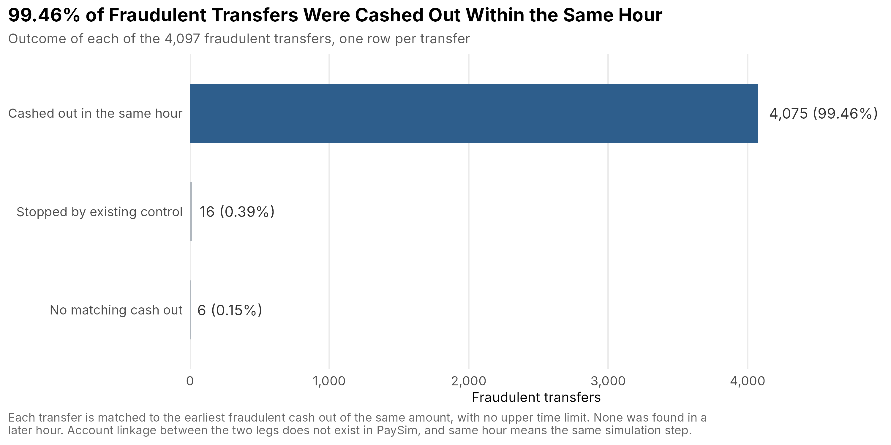
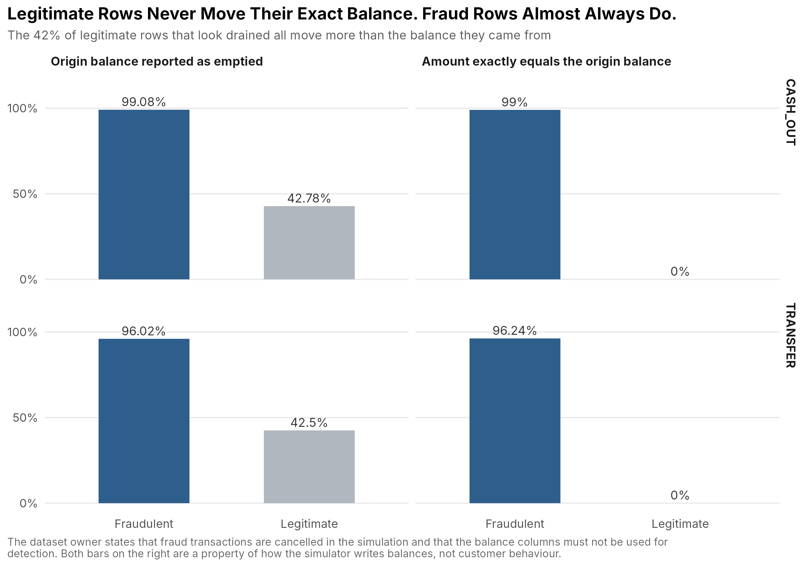
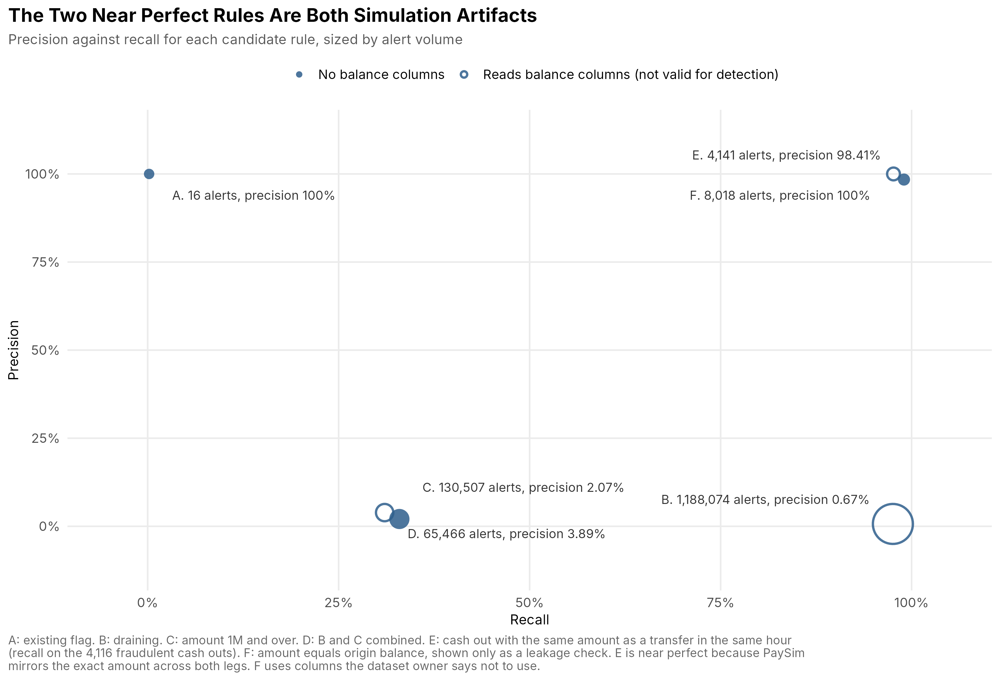
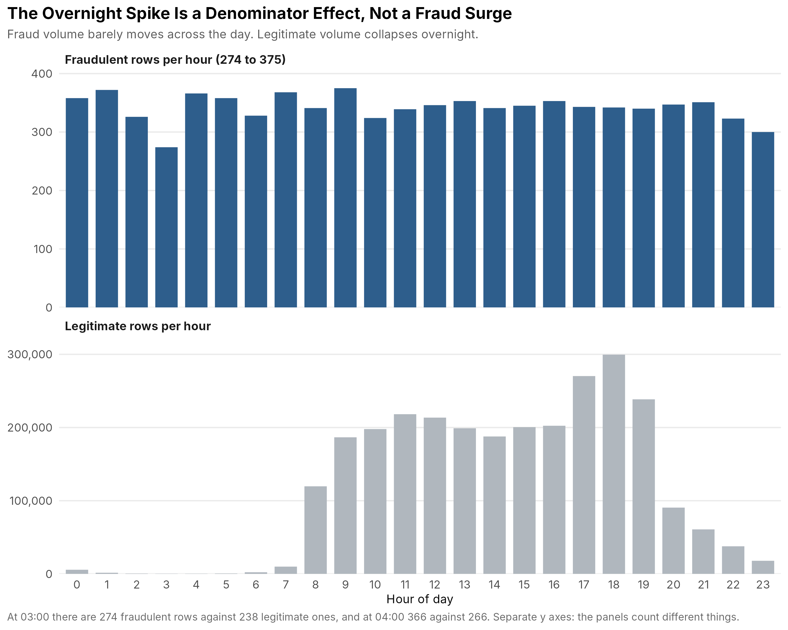

# PaySim Fraud Chain and Velocity Analysis

Mapping the transfer to cash out chain in mobile money fraud, measuring how fast the money leaves, and testing which detection rules would survive contact with production, including the ones that only look good because of how the data was simulated.

**Tools:** Google BigQuery (SQL) · R (tidyverse, ggplot2) · Tableau Public
**Dataset:** PaySim synthetic mobile money transactions, 6,362,620 records across 743 simulated hours (31 days)

---

## Executive Summary

PaySim models account takeover. A fraudster takes control of a customer account, transfers the balance to a second account, and cashes it out. The interception point is the cash out, and the window is short.

- **Fraudulent transfers moved 6,067,213,184 in local currency, and fraudulent cash outs moved 5,989,202,244** (98.7% of the transfer value). The two legs are the same money seen twice, so they are never added together.
- **4,075 of 4,097 fraudulent transfers (99.46%) were cashed out within the same simulated hour.** The search for a matching cash out had no upper time limit, and none was found in a later hour.
- **The existing control flagged 16 transfers, 0.19% of all 8,213 fraudulent rows.** When it fired it stopped the money every time. The problem is coverage: it is documented as firing above 200,000, yet it fired on 16 of 409,110 transfers above that amount.
- **The most useful result is a warning.** Two rules reach almost perfect precision and recall in this data, and both are artifacts of the simulator. One reads balance columns that the dataset owner says must not be used for detection. The other relies on PaySim copying the exact amount from the transfer to the cash out. A rule that is near perfect on synthetic data has to be checked for leakage before anyone believes it.

---

## Live Dashboard

**[View the interactive Tableau Public dashboard](https://public.tableau.com/app/profile/abdulrashid.mustafa/viz/paysim-fraud-chain-analysisDashboard/Dashboard1)**

---

## 1. Business Task

**Problem.** A mobile money provider is losing funds to account takeover fraud. Fraudsters gain control of customer accounts, move the funds to an account they control, and cash out.

**Objective.** Map the flow of money, measure how quickly it leaves, evaluate the existing control, and test which detection rules would hold up in production.

**Stakeholders.** Fraud Operations, Risk Management, Executive Leadership.
**Audience.** Non technical decision makers, plus technical reviewers of the analysis.

**Guiding questions.**
1. How much value is at risk, and how does the existing control actually perform?
2. What is the chain from fraudulent transfer to cash out, and how long does it take?
3. Do amount and balance behaviour predict fraud well enough to build a rule on, and what does each rule cost in alerts?

---

## 2. Data Sources and Limitations

**Source.** PaySim synthetic dataset by Edgar Lopez-Rojas, published on Kaggle under CC BY-SA 4.0. It is generated from one month of real mobile money logs from an operator in an African country, scaled down to a quarter of the original size.

**Structure.** 6,362,620 rows, 11 columns, five transaction types. The Kaggle description says 744 hourly steps, but the file contains 743 (steps 1 to 743), which still covers 31 simulated days.

**ROCCC assessment.**

| Criterion | Assessment |
|---|---|
| Reliable | Derived from real operator logs, academically published, widely used as a fraud benchmark. Its known artifacts are documented below. |
| Original | Primary synthetic generation, not a redistributed extract |
| Comprehensive | Full ledger with balances, counterparties and ground truth labels |
| Current | Not recent, and synthetic, so it supports method rather than production thresholds |
| Cited | Licensed and attributed on Kaggle |

**Limitations, stated openly.**

1. **The balance columns are not valid for detection.** The dataset description states that fraud transactions are cancelled in the simulation and that oldbalanceOrg, newbalanceOrig, oldbalanceDest and newbalanceDest must not be used for fraud detection. The data confirms why (see Q3). Rules built on them are reported only to show the leakage.
2. **Fraud is simulation bound.** Fraud occurs only in TRANSFER and CASH_OUT, so every rate is computed within those two types (2,770,409 rows), never against the full ledger.
3. **The two legs cannot be linked by account.** Not one account that receives a fraudulent transfer goes on to start a fraudulent cash out (0 links). Chains are matched on amount and time instead.
4. **Same hour means the same simulation step.** The simulator writes the cash out in the same step as the transfer. That makes the velocity result a property of the simulator as much as a finding about fraud behaviour. Real chains are slower and messier.
5. **Hour of day is an assumption.** The source does not say what clock time step 1 represents. Treating it as 00:00 is supported by the daily volume cycle, but it is still an assumption.
6. **Legitimate volume collapses after day 17.** Days 1 to 17 (except days 3 to 5) carry 149,042 to 250,812 legitimate rows a day. Days 18 to 30 carry 3,442 to 24,163, and day 31 carries none at all, while fraud continues at its usual pace. Daily fraud rates are only comparable inside the full volume days.
7. **Amounts are in local currency.** The dataset does not name the currency, so no currency symbol is used.
8. **Privacy.** Not applicable. The data is entirely synthetic.

---

## 3. Data Cleaning and Feature Engineering

All transformation was done in BigQuery, producing `paysim.cleaned_transactions`. Full code in `sql/02_cleaning.sql`.

| Transformation | Rationale |
|---|---|
| `step` mapped to `sim_day` (1 to 31) and `hour_of_day` (0 to 23) | The raw step is a linear hour counter with no calendar meaning |
| `is_orig_drained` flag | Origin balance reported as emptied, the behaviour tested in Q3 |
| `orig_balance_error`, `dest_balance_error` | Measures ledger inconsistency instead of ignoring it |
| Drained ratio computed at query time, not stored | Ratios against near zero balances explode, so it is reported as a median |
| No rows dropped | Removing inconsistent rows would remove genuine fraud cases |

Row count was verified as unchanged, and the day and hour ranges were checked against their expected bounds. `sql/08_validation_checks.sql` exports every reconciliation check to `data/validation_checks.csv`.

---

## 4. Analytical Findings

### Q1. Value at risk and control performance

| Metric | Value |
|---|---|
| Value of fraudulent transfers | 6,067,213,184.01 |
| Value of fraudulent cash outs | 5,989,202,243.83 |
| Cash out value as a share of transfer value | 98.7% |
| Fraudulent rows | 8,213 (4,097 transfers, 4,116 cash outs) |
| Flagged by `isFlaggedFraud` | 16, all of them fraud |
| Share of fraudulent rows flagged | 0.19% |
| Share of fraudulent transfers flagged | 0.39% |

**The control works when it fires, but it almost never fires.** All 16 flagged transfers were fraud, and in all 16 the origin balance did not move, so the transfer was stopped. The simulator also records 16 fraudulent cash outs of zero in the same hours, meaning the follow up cash out had nothing to take.

The dataset documents the flag as firing on any transfer above 200,000. There were 409,110 transfers above that amount, 2,740 of them fraudulent, and the flag fired on 16. Whatever logic drives it, it is not the documented threshold, and it covers almost none of the fraud.

### Q2. Chain velocity

Each fraudulent transfer was matched to the earliest fraudulent cash out of exactly the same amount, at the same step or any later step, with one result per transfer.

| Outcome | Transfers | Share | Value |
|---|---|---|---|
| Cashed out in the same hour | 4,075 | 99.46% | 5,983,699,208.41 |
| Stopped by the existing control | 16 | 0.39% | 77,785,563.69 |
| No matching cash out | 6 | 0.15% | 5,728,411.91 |

No transfer was cashed out in a later hour. Every fraudulent transfer that the control did not stop, and that reached a cash out at all, reached it within the same simulated hour.

**A correction to an earlier version of this project.** The first version joined transfers to cash outs inside a one hour window and counted join rows. That produced 4,308 "chains" for 4,097 transfers, a matched value of 8,313,699,208.41 (more than all fraudulent transfer value), and 36 chains that appeared to take an hour. All 36 carried the amount 10,000,000, which appears on 145 fraudulent transfers, so they were collisions between different chains rather than slow ones. The one hour window also made it impossible for any chain to look slower. Both problems are fixed above.



The operational consequence is direct. A control that depends on a person working a review queue arrives after the money has gone. Interception has to be automated and inline, at the cash out.

### Q3. Amount, balance behaviour, and what each rule costs

**Amount carries real but narrow signal.** Fraudulent transfers average 1,480,891.67 against 906,229.01 for legitimate transfers, yet the median fraudulent transfer (445,705.76) is lower than the median legitimate one (486,521.91). The averages are pulled up by a minority of very large frauds, and the bands show where:

| Amount band | Transactions | Fraud rate | Lift vs baseline |
|---|---|---|---|
| under 1K | 7,801 | 0.743% | 2.51x |
| 1K to 10K | 71,040 | 0.310% | 1.04x |
| 10K to 100K | 757,271 | 0.189% | 0.64x |
| 100K to 1M | 1,803,790 | 0.211% | 0.71x |
| **1M and over** | **130,507** | **2.073%** | **6.99x** |

The under 1K band also shows lift, but it holds only 58 fraud cases. The 1M and over band is the one with both lift and volume.

**Account draining is a simulation artifact, not customer behaviour.** At first sight it looks decisive: 97.55% of fraudulent rows empty the origin balance, against 42.72% of legitimate rows. A closer look at how the simulator writes balances changes the reading completely:

| | Fraudulent | Legitimate |
|---|---|---|
| Transfers where the amount exactly equals the origin balance | 96.24% | 0.00% |
| Cash outs where the amount exactly equals the origin balance | 99.00% | 0.00% |
| Transfers with a destination balance of zero before and after | 99.29% | 0.02% |
| Median of amount divided by origin balance | 1.00 | 5.78 |

Not one legitimate row moves exactly its origin balance. The 1,180,062 legitimate rows that look drained all move more than the balance they came from, which is a ledger inconsistency, not a customer emptying a wallet. Fraud rows, on the other hand, take the balance to the exact unit. This is how the simulator writes cancelled fraud, and it is the reason the dataset owner says these columns must not be used.



### Rule performance, measured

Rules A to D and F are scored on all 8,213 fraudulent rows. Rule E only fires on cash outs, so its recall is measured on the 4,116 fraudulent cash outs.

| Rule | Uses balance columns | Alerts | Caught | Precision | Recall | Alerts per catch |
|---|---|---|---|---|---|---|
| A. Existing flag | no | 16 | 16 | 100.00% | 0.19% | 1.0 |
| B. Account draining only | yes | 1,188,074 | 8,012 | 0.67% | 97.55% | 148.3 |
| C. Amount 1M and over | no | 130,507 | 2,706 | 2.07% | 32.95% | 48.2 |
| D. Draining and 1M and over | yes | 65,466 | 2,548 | 3.89% | 31.02% | 25.7 |
| E. Cash out mirrors a transfer of the same amount in the same hour | no | 4,141 | 4,075 | 98.41% | 99.00% | 1.0 |
| F. Amount equals origin balance (leakage check) | yes | 8,018 | 8,018 | 100.00% | 97.63% | 1.0 |

How to read this table:

- **B shows why recall alone is meaningless.** 97.55% recall sounds strong until you see 1,188,074 alerts, or 148.3 alerts per fraud caught.
- **B, D and F are not valid rules** because they read the balance columns. F is included on purpose: a perfect score is the clearest sign of leakage.
- **E is the right idea with an optimistic number.** It intercepts the cash out by tying it to the transfer that funded it, which is exactly where Q2 says interception has to happen. Its precision is inflated because PaySim copies the exact transfer amount into the cash out. Real mule activity splits, rounds and delays.
- **C is the only rule here that is both valid and honest about its cost.** It is weak on its own, which is the realistic baseline a production rule would have to beat.



### Temporal pattern, and why the overnight spike is not a fraud surge

The fraud rate reaches 57.9% at 04:00. That is a denominator effect. Fraud volume stays between 274 and 375 rows in every hour of the day, while legitimate volume ranges from 238 rows at 03:00 to 299,591 at 18:00. At 03:00 and 04:00 there are more fraudulent rows than legitimate ones (274 against 238, and 366 against 266).

The practical value is in how rules behave by hour. The same amount rule (C) reaches 56.18% precision between 00:00 and 06:59, against 1.48% for the rest of the day. That argues for hour aware thresholds in automated rules, not for more people on the night shift.



---

## 5. Visualisations

| Figure | Takeaway |
|---|---|
| `01_fraud_rate_by_hour.png` | Fraud rate peaks overnight, when legitimate volume is lowest |
| `01b_fraud_volume_vs_rate.png` | Fraud volume is flat across the day; the spike comes from the denominator |
| `02_chain_outcomes.png` | 99.46% of fraudulent transfers were cashed out within the same hour |
| `03_amount_distribution.png` | The 1M and over band carries 7x the baseline fraud rate |
| `04_account_draining_signal.png` | The draining signal is a balance artifact of the simulator |
| `05_daily_fraud_trend.png` | Legitimate volume collapses after day 17 while fraud keeps its pace |
| `06_rule_tradeoff.png` | The two near perfect rules are both simulation artifacts |

---

## 6. Recommendations

**1. Intercept at the cash out, automatically and inline.** Hold a cash out from an account that received a transfer shortly before, and score the pair together. Q2 shows the window is too short for any manual queue. In PaySim the amount based version of this rule (E) catches 4,075 of 4,116 fraudulent cash outs at 98.41% precision, but that figure is optimistic for the reasons above. In production the link should be the receiving account, and precision must be measured on real data before the hold goes live.

**2. Keep the existing flag as a hard block, and find out why it fires.** Every time it fired, it stopped real fraud and the money never left. Its documented logic does not match its behaviour (16 flags against 409,110 transfers above 200,000), so the first step is to establish its real trigger before relying on it or widening it.

**3. Make automated thresholds hour aware.** The same amount rule is about 38 times more precise overnight (56.18% against 1.48%). A threshold that would drown a team in daytime alerts can run tighter at night at a fraction of the cost.

**4. Run a leakage check before trusting any rule.** Rules B, D and F look useful only because of how the simulator writes balances. Any rule that scores close to perfect on synthetic data should be tested against the data's own documentation before it is presented as a finding.

---

## 7. Further Exploration

- **Measure the velocity hold on real data.** Link cash outs to the transfers that funded them through the receiving account, and count how many legitimate pairs a short hold would catch. This is the most important missing number.
- **Establish what drives `isFlaggedFraud`.** It stopped every case it caught, so understanding its trigger is the cheapest way to more coverage.
- **A supervised model trained without the balance columns,** benchmarked against rule C, to measure how much lift a model adds over simple logic.
- **Network analysis of mule accounts,** to detect coordinated rings rather than isolated chains.
- **False positive cost modelling.** Each alert has a handling cost and each hold has a customer friction cost. The rule table counts alerts but does not price them.
- **Validation against real dispute outcomes,** which synthetic data cannot provide.

---

## 8. How to Reproduce

1. Download the PaySim dataset from Kaggle
2. Load it into BigQuery as `paysim.raw_transactions`
3. Run `sql/01_profiling.sql` through `sql/08_validation_checks.sql` in order
4. Export each result marked `Export -> data/<file>.csv` to that file
5. From the project root, run `R/01_time_series.R` then `R/02_visuals.R`
6. Figures are written to `figures/` at 300 dpi

Required R packages: `tidyverse`, `scales`

---

## 9. Repository Structure

```
paysim-fraud-chain-analysis/
├── README.md
├── data_dictionary.md
├── sql/         01 profiling, 02 cleaning, 03 to 07 analysis, 08 validation checks
├── R/           01 time series, 02 visuals
├── data/        aggregated exports only, no raw data
├── figures/     300 dpi output
└── tableau/     dashboard link, build notes and screenshot
```

---

## 10. Attribution

PaySim dataset by Edgar Lopez-Rojas, available on Kaggle under CC BY-SA 4.0. Analysis, code and interpretation are my own.

## 11. AI Assistance

AI tools (Claude and Gemini) were used as pair programming and review assistants for SQL, R debugging, and challenge of the analytical framing. All analytical decisions, number reconciliation and business recommendations were defined and validated by me, and every figure in this README is copied from the CSV exports in `data/`.
